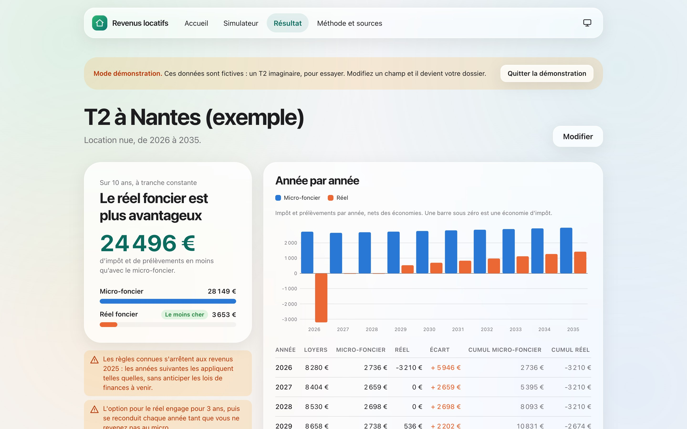
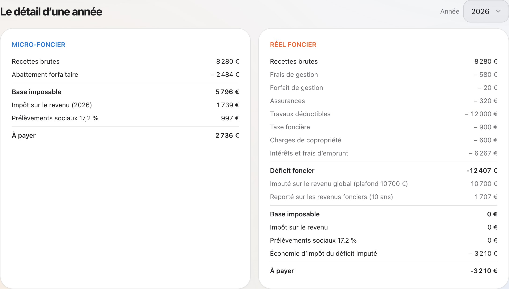
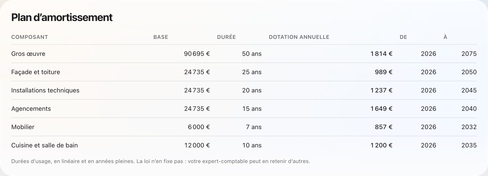
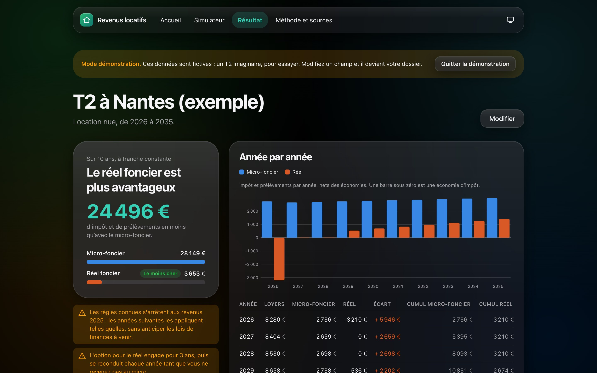

# Revenus locatifs

Micro ou réel ? Le simulateur compare les régimes d’imposition d’un bien en location, nue ou
meublée, année par année sur dix ans, et donne les cases à reporter sur la déclaration.

**Démo :** https://revenus-locatifs.vercel.app, ou directement
[l’exemple fictif en mode démonstration](https://revenus-locatifs.vercel.app/resultat?exemple).



> Revenus locatifs est un outil indépendant, sans lien avec l’administration fiscale : ses
> résultats sont indicatifs et ne remplacent pas un conseil fiscal.

## Fonctionnalités

- **Location nue** : micro-foncier (abattement de 30 %) contre réel, avec le déficit foncier
  calculé comme l’administration le fait : intérêts imputés d’abord sur les loyers, déficit des
  autres charges imputé sur le revenu global jusqu’à 10 700 € (21 400 € pour la rénovation
  énergétique), report du reste sur dix ans.
- **Location meublée (LMNP)** : micro-BIC (abattement de 50 %, minimum 305 €) contre réel
  simplifié, avec un plan d’amortissement par composants, le plafonnement de l’amortissement au
  résultat (art. 39 C) et le report sans limite de l’excédent.
- **Projection pluriannuelle** : loyers revalorisés, charges indexées, intérêts décroissants d’un
  tableau d’amortissement du prêt, travaux l’année où ils sont payés, déficits et amortissements
  reportés d’une année sur l’autre, CSG déductible comptée l’année suivante.
- **Un verdict chiffré** : l’économie cumulée du régime le moins cher, l’année où le micro
  redevient avantageux, et les engagements que l’option entraîne.
- **Le détail d’une année** dans chaque régime, ligne par ligne, et **les cases à reporter**
  (2042 4BE, 4BA, 4BC, 4BB ; 2044 ; 2042 C PRO 5ND, 5NA, 5NY ; 2031 et 2033-B).
- **Un mode démonstration** avec un exemple fictif clairement signalé.
- **Vos données restent dans votre navigateur** : pas de compte, pas de serveur, une sauvegarde
  locale que vous pouvez effacer.









<p align="center">
  
</p>

## Principes

- **Le calcul officiel, ligne par ligne**, en décimal exact, testé sur des cas chiffrés tirés de
  la doctrine. Les règles et leurs sources sont dans [`docs/regles-fiscales.md`](docs/regles-fiscales.md).
- **Des règles versionnées par année de revenus** : une projection applique les règles connues et
  le dit.
- **Dire ce que l’outil ne fait pas** : un bien à la fois, pas de meublé de tourisme, pas de
  dispositif de défiscalisation, pas de plus-value à la revente. La liste complète est sur la
  page Méthode.

## Stack

| Domaine     | Outils                                                                           |
| ----------- | -------------------------------------------------------------------------------- |
| Framework   | Nuxt 4, Vue 3, TypeScript strict, Pinia                                          |
| Interface   | Tailwind CSS 4, polices du système, mode sombre, navigation adaptée au téléphone |
| Calcul      | decimal.js (décimal exact), Zod pour valider toute saisie                        |
| Hébergement | Statique ou Vercel ; aucune route serveur                                        |
| Qualité     | Vitest, ESLint, Prettier, GitHub Actions                                         |

## Lancer le projet

Prérequis : Node.js 22 ou plus récent.

```bash
npm install
npm run dev
```

| Commande            | Rôle                                                                               |
| ------------------- | ---------------------------------------------------------------------------------- |
| `npm run dev`       | serveur de développement                                                           |
| `npm test`          | tests unitaires (Vitest)                                                           |
| `npm run lint`      | ESLint                                                                             |
| `npm run typecheck` | vérification des types                                                             |
| `npm run format`    | mise en forme (Prettier)                                                           |
| `npm run build`     | build de production                                                                |
| `npm run captures`  | captures d’écran du README (Chrome ou Edge installé, build lancé sur le port 3002) |

## Organisation du code

- `shared/model` : le dossier (bien, foyer, emprunt, travaux) et son schéma de validation.
- `shared/tax/rules.ts` : les règles par année de revenus, chaque valeur sourcée.
- `shared/tax/foncier.ts`, `shared/tax/bic.ts` : les quatre régimes, avec les reports.
- `shared/tax/amortissements.ts`, `shared/loan` : plan d’amortissement du meublé et tableau du prêt.
- `shared/projection` : les années brutes puis la comparaison sur l’horizon choisi.
- `shared/tax/cases.ts` : les cases à reporter.
- `app/` : l’interface Nuxt, sans logique fiscale.

## Du même auteur

[Crypto-plusvalue](https://github.com/maxence-svensson/crypto-plusvalue) : le calcul des
plus-values crypto pour le formulaire 2086, avec le même principe, tout dans le navigateur.

## Licence

MIT.
